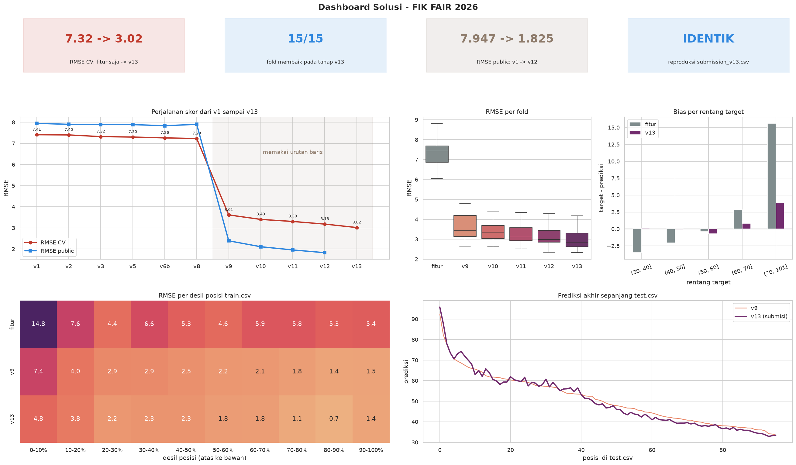

# FIK FAIR 2026: Data Science Competition

Team **Second Choice**'s solution for the [FIK FAIR 2026 Data Science Competition](https://www.kaggle.com/competitions/data-science-competition-fikfair2026) on Kaggle. The task is tabular regression: predict an *Anonymous Competition Score* from 24 anonymized numerical features, with 382 training rows, 96 test rows, and RMSE as the metric.

| Leaderboard | RMSE | Rank |
|---|---:|---:|
| Public (29 rows) | 1.72221 | **1st** |
| Private (67 rows, final) | 3.15737 | **5th** |

The final submission scores 3.016 RMSE in local cross-validation (5-fold × 3 repeats), close to its private score.



## Approach

The pipeline has three layers. Every layer is validated on the same fixed folds, and the public score was never used to select parameters.

1. **Feature layer (v1–v8, CV RMSE ~7.2).** Two tabular foundation models, TabICLv2 and TabPFN-3.5, make predictions through in-context learning, and their outputs are averaged. This average is blended 70:30 with an RBF SVR that is itself averaged over several PCA dimensions and trained on a log(y − 30) target. All three models use transductive pseudo-labelling on the test features. No test labels are involved.
2. **Row-order layer (v9, CV RMSE 3.61).** `train.csv` is almost sorted by target in descending order (Spearman ρ = −0.981). Indirect evidence (ρ = −0.806 between test row position and feature-only predictions) shows that `test.csv` follows the same order. This layer averages a position-to-target quantile map with the feature predictions re-sorted into file order. The organizers confirmed that using row order is allowed.
3. **Correction layer (v10–v13, CV RMSE 3.02).** This layer has four stages:
   - a rank correction based on feature-space neighbours
   - Ridge regression on detrended residuals
   - local-linear detrending with position interactions
   - RBF Kernel Ridge

   Each stage is selected by nested CV and then averaged 50:50 with the previous version.

| Version | Main change | CV RMSE | Public |
|---|---|---:|---:|
| v1 | TabICLv2 + multi-PCA SVR | 7.41 | 7.947 |
| v8 | + TabPFN-3.5, pseudo-labelling, SVR plateau | 7.23 | 7.900 |
| v9 | Row-order quantile mapping | 3.613 | 2.387 |
| v10 | Neighbour-based rank correction | 3.401 | 2.107 |
| v11 | Ridge on detrended residuals | 3.303 | 1.955 |
| v12 | Local-linear detrending + position interactions | 3.179 | 1.825 |
| **v13** | **Kernel Ridge on residuals (final)** | **3.016** | **1.722** |

## Repository Structure

```
data/          Official competition data and rules
notebooks/     final.ipynb (final solution), v1–v13.ipynb (submitted versions),
               build_*.py (scripts that generate each notebook)
artifacts/     Frozen feature-layer outputs from the GPU run, the input for INFERENCE mode
eda/           Analysis and experiment scripts, one folder per round (eda/v2 … eda/v9)
docs/          Reports and research notes (in Indonesian)
outputs/       Figures, OOF predictions, and logs from eda/ scripts and the final notebook
results/       Official Kaggle run outputs for v1–v9
```

Documents in `docs/`:

- [`preliminary_report.pdf`](docs/preliminary_report.pdf): the report submitted for the preliminary round
- `laporan.md`: the full solution write-up
- `eda_findings.md`: the experiment log
- `v10_*.md` to `v13_*.md`: notes on each correction stage

## Reproducing

```bash
python -m venv .venv && source .venv/bin/activate
pip install -r requirements.txt jupyter
jupyter nbconvert --to notebook --execute notebooks/final.ipynb --output final_executed.ipynb
```

- **`INFERENCE` mode (default, CPU, ~75 s).** Loads `artifacts/` and recomputes the EDA, the row-order layer, and v10–v13. The output is byte-identical to the final submission (SHA256 `0bd8ba26…07af14`), and the notebook raises an error if any prediction differs by more than 1e-6.
- **`FULL` mode (`CFG.RUN_MODE = 'FULL'`, Kaggle 2× T4, internet on).** Retrains TabICLv2, TabPFN-3.5, and the SVR. This mode needs a Prior Labs token stored as the Kaggle Secret `TABPFN_TOKEN`.
- **Builder script.** The notebook is generated by `notebooks/build_final.py`. Edit the builder, not the `.ipynb`.
- **Experiment scripts.** Run these from the repo root, e.g. `python eda/v9/58_deep_audit.py`.

## Notes

- Layers v9–v13 rely on the test file keeping the same row ordering. They do not transfer to unordered data. Without ordering, the best model is v8 (CV RMSE ~7.2).
- The solution uses no external data, does not probe the leaderboard, and does not reconstruct test targets. See Section 8 of [`docs/laporan.md`](docs/laporan.md) for the full rule-compliance statement.

## Team

Riantama Putra (lead), Haikal Muhammad Royyan, Defina Aurellia Ningsih, Taufiq Muhammad Arif
